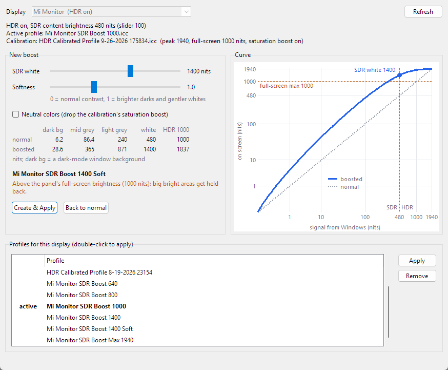

# SDR Boost

Brighter SDR content in Windows HDR mode.

With HDR on, Windows shows SDR content (desktop, browser, apps) at most 480 nits, even with
**SDR content brightness** at 100 and a monitor that can do 2000. The limit is enforced by
Windows itself: the setting rejects anything higher. SDR Boost gets around it with a monitor
color profile. The GPU applies the profile's curve to the final HDR signal, so SDR white can land at
any level you pick, up to your panel's peak.



## Download

Grab the latest [release](../../releases/latest):

- **`sdr-boost-gui.exe`**: the app. No Python needed.
- **`sdr-boost.exe`**: the command line version.
- **`SDR-Boost-v1.0.0.zip`**: both, plus the batch runners and Python source.

## Requirements

- Windows 11 with HDR turned on and **SDR content brightness at 100**
- A GPU that supports Windows' hardware color pipeline (NVIDIA GTX 10 series or newer, AMD RX 400 or newer,
  Intel Ice Lake or newer)
- A profile from the **Windows HDR Calibration** app (free on the Microsoft Store) for the monitor. Boost
  profiles are copies of it, so they keep its peak brightness, full-screen brightness and saturation setting.
- Python 3.9+ only if you run from source

## Using the app

1. Pick an **SDR white** level: how bright white gets, in nits. Windows' own maximum is 480.
2. Pick a **softness**: 0 keeps normal contrast; around 1 gives brighter darks and midtones with gentler
   whites, which looks better at high levels.
3. Watch the curve and the table, which show what each shade and HDR highlights end up at.
4. Hit **Create & Apply**. **Back to normal** switches to your calibration profile.

The list at the bottom holds every HDR profile for the display: double-click one to switch to it, or remove
boost profiles you don't need. You can also switch in **Settings > System > Display > Color profile**.

## Command line

```
sdr-boost status                     HDR state, active profile, calibration values
sdr-boost list                       the monitor's HDR profiles (* = active)
sdr-boost preview 1400 --soft 1      what a boost would do, without changing anything
sdr-boost create 1400 --soft 1       build, install and link it
sdr-boost create 1200 --apply        ...and make it active right away
sdr-boost apply "1400 soft"          switch to a profile (full name, what follows "SDR Boost", or a unique part)
sdr-boost normal                     back to the HDR Calibration profile
sdr-boost remove "1400 soft"         unlink and delete a boost profile
```

| Option | Meaning |
|---|---|
| `WHITE` | SDR white in nits. Values above the calibrated peak are capped. |
| `--soft N` | 0 = same contrast as normal, 1 = darks and midtones brighter relative to white, up to 3 = flatter. |
| `--neutral` | Drop the saturation boost from HDR Calibration (colors look stronger the brighter things get). |
| `--monitor TEXT` | Pick the display by part of its name when more than one has HDR on. |
| `--base FILE` | Build from a specific calibration profile instead of the monitor's newest. |

## How it works

Windows' color pipeline lets a display profile carry an MHC2 tag: a color matrix plus a 1D LUT that the GPU
applies after the signal has been encoded for the wire, which in HDR mode means PQ. SDR Boost copies your HDR
Calibration profile and writes a new LUT into it:

- **Up to 480 nits in** (all SDR content): scaled to the chosen white level, or bent by the softness setting.
- **Above that** (HDR content only): a smooth shoulder that continues at the same slope and lands on the
  calibrated peak, so HDR highlights still fit on the panel.

Profiles are installed into the Windows color store and linked to the display as advanced color profiles
for the current user. No admin rights needed. A copy of each one is kept in `profiles\`.

## Things to know

- The curve applies to everything in HDR mode, HDR games and movies included: midtones get brighter and
  highlights get squeezed. Switch back to normal for accurate HDR.
- White levels above the panel's full-screen brightness only show in smaller bright areas; the monitor holds
  large bright areas back. Very high levels with no softness can look harsh, so try some softness first.
- Running Windows HDR Calibration again makes the new calibration profile active, which turns the boost off.
  Create the boost again so it picks up the new calibration.

## License

MIT
